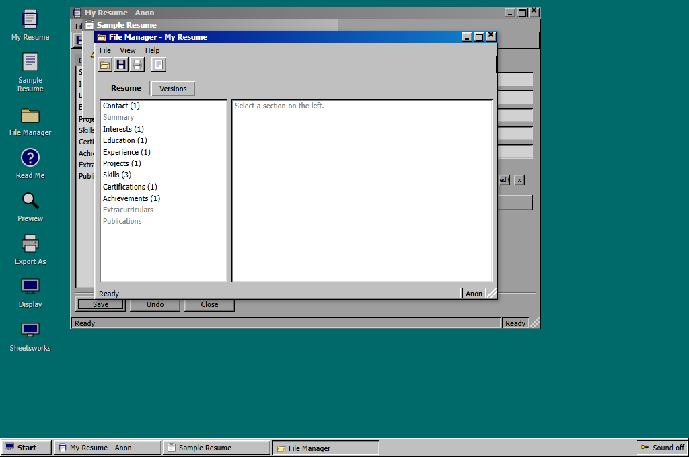
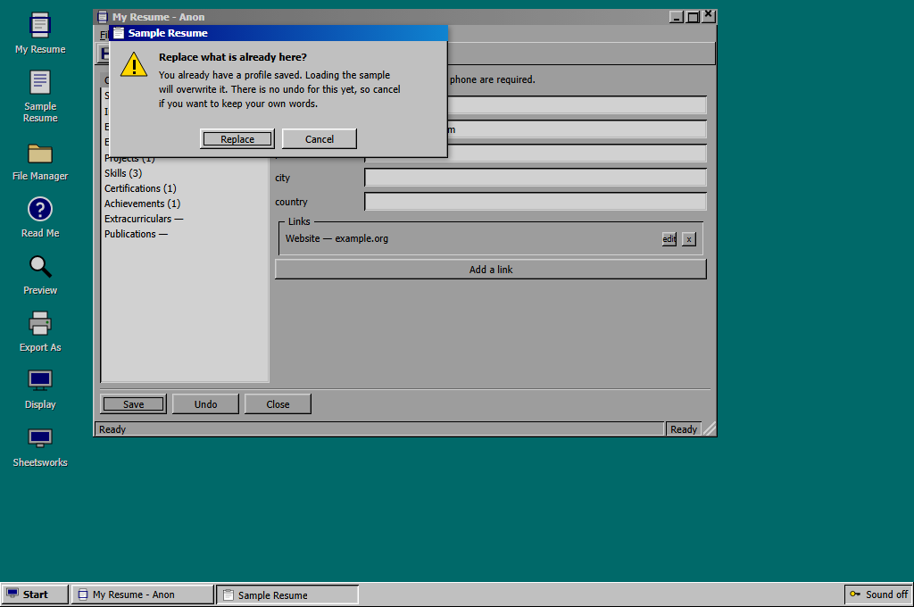
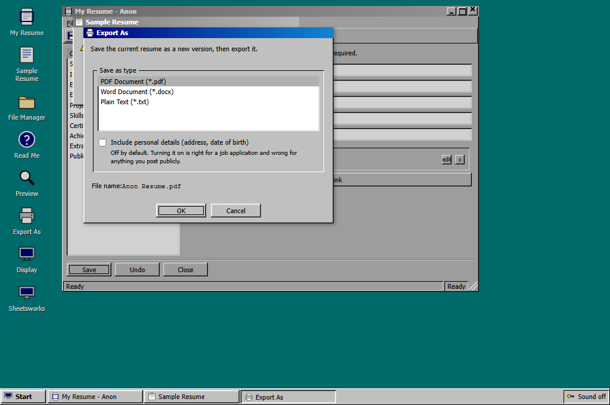

# Sheetsworks

A local AI resume builder whose entire interface is a working Windows 95 desktop.

<video src="docs/brag.mp4" poster="docs/brag-poster.jpg" controls preload="metadata" width="100%"></video>

If the player does not load, the file is [`docs/brag.mp4`](docs/brag.mp4) (25 seconds).

## What it is

A FastAPI + SQLite app you run on your own machine. It keeps your profile in a
local database, renders a one-page resume, and exports it. No account, no cloud
storage, no telemetry.

The interface is not a theme on top of a normal web app. It is a Windows 95
desktop: free-floating beveled windows you can drag, resize, raise and close, a
taskbar with a Start menu and a tray, modal dialogs, list boxes. It is written in
plain HTML, CSS and JavaScript with no front-end dependencies and no build
step: a Win95 bevel is four `box-shadow` insets.

The AI assists with wording. It does not write your history. Every bullet it
suggests is checked against the facts you entered, and anything it wants to say
beyond those facts is turned into a question you answer first.

## Screenshots







## Run it

```powershell
python -m venv .venv
.\.venv\Scripts\Activate.ps1
pip install -r requirements.txt
Copy-Item .env.example .env      # then put one provider key in it
.\.venv\Scripts\python.exe -m uvicorn app.main:app --reload
```

Then open <http://localhost:8000>.

On macOS or Linux the same steps work with `python -m venv .venv`,
`source .venv/bin/activate` and `cp .env.example .env`.

## Configuration

Pick one provider in `.env` and give it a key:

```
LLM_PROVIDER=anthropic      # gemini | groq | mistral | anthropic | openrouter
ANTHROPIC_API_KEY=...
```

Each provider has a default model; `LLM_MODEL` overrides it. OpenRouter has no
default on purpose, because the free model ids there rotate.

The AI features need a reachable provider. To check the round trip without
touching the UI:

```powershell
.\.venv\Scripts\python.exe -m app.cli --check-llm
```

That command makes a live call, so it needs a real key. The test suite covers
the same code path with a mocked transport instead.

## Exports

`Export As` writes PDF, DOCX or TXT. The live preview is not an approximation of
the export: it calls the same WeasyPrint renderer, so what you look at is the
real artifact. The test suite re-opens the generated PDF with pdfplumber and
checks the text is still extractable, which is the part an applicant tracking
system actually reads.

## Tests

```powershell
.\.venv\Scripts\python.exe -m pytest
```

603 tests pass, 2 are skipped (they need a browser on one path). The suite also
drives the real UI in a headless browser: the browser-check harness in `tools/`
caught the preview overlay, the clipped export dialog and a raise-on-click bug,
so it lives in the repository rather than in a scratch folder.

## Layout

```
app/
  main.py        FastAPI app: profile, versions, assist, preview, export
  llm.py         one adapter per provider
  assist.py      the interview flow and the fact guard
  models.py      the profile schema
  rules.py       resume rules: page budget, ATS checks
  render/        build, pdf (WeasyPrint), docx, txt
  static/win/    the Windows 95 shell, win95.css design system, the editor
  cli.py         --check-llm, a live provider round trip
prompts/         the instructions sent to the model
templates/       resume.html, the single page both preview and PDF use
tools/           browser check harnesses and screenshot helpers
docs/            the video, its poster frame, and the screenshots above
```

## Known limits

The AI assist flow cannot be verified end to end in this environment: the
configured Gemini project returns `403 Your project has been denied access`, so
the assist path here is exercised by tests with a mocked provider transport
rather than by a live call. Everything else in the list above runs against the
real code.
